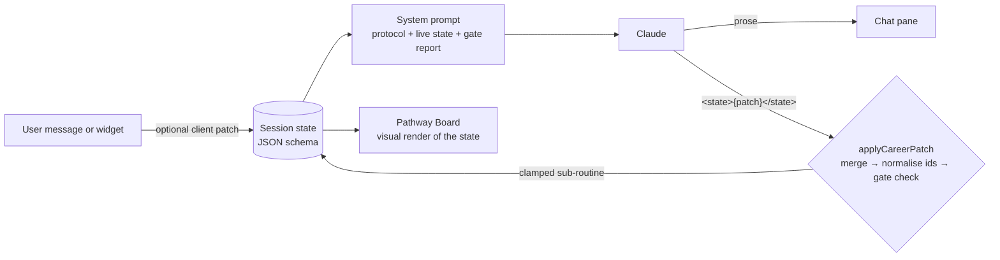

# Career Pathway Coach — design

A sixth space in the Purposefields Coaching Hub (`remixed-a377854c (1).tsx`, section
`CAREER PATHWAY COACH`). It runs the **Employment Pathway Facilitation Engine**: six gated
phases that take someone from their values to three commitments locked into their calendar.

## How it works

* **The model writes prose plus a state patch.** Every reply ends with `<state>{…}</state>`, a partial
  of the session schema. Objects deep-merge and arrays replace. The patch is stripped before
  the reply is shown.
* **The app enforces the gates, not the model.** `careerGates()` checks every exit condition. If
  the model moves `current_sub_routine` past a phase whose gate is unmet, the app sends it back to
  the sub-routine that owns the first unmet item and shows an "Exit gate holding Phase N" banner.
  Each turn the system prompt includes the current gate report, so the model knows what's missing.
* **Widgets write state directly.** Structured inputs (values, constraints, role choice,
  confirmation, Rule-of-3, lock) patch state on the client and also send a plain-language message,
  so the model stays in sync.
* **Persistence.** The state and the last 80 messages are saved to `window.storage` under
  `pf_career_session_v1`, so a session resumes where it stopped. **New session** (tap twice) resets it.

## Layout

| Width | Layout |
|---|---|
| ≥ 980px | Header → **Phase rail** → two columns: coach chat on the left, **Pathway Board** on the right |
| < 980px | Header → Phase rail → tabs (💬 Coach / 🗺 Pathway board). A dot on the Board tab shows new updates |

The **Phase rail** mirrors the state-machine grid. It shows six phases with a dot per sub-routine
(done / active / locked), and tapping a phase scrolls the board to that section.

## What each phase looks like

| Phase | Widget in chat | What the board shows |
|---|---|---|
| **1 Boundary Envelope** | 1.1 value picker: 5 colour-coded clusters, hard limit of 4–6 · 1.4 constraints form (exact salary + currency, contract, Remote/Hybrid/Onsite with office-days or commute follow-up, pace, novelty, non-negotiables) | Value chips in cluster colours · 3-step identity path (Today → On teams → Horizon) · North Star quote with a 75–120 word counter · constraint tiles |
| **2 Tri-Factor Audit** | — (conversational) | Three columns (Skills / Knowledge / Passions), each with a 5-box progress meter, colour tags per item and a ●●○ proficiency rating for skills |
| **3 Role Architecture** | — | Role cards grouped by motion type (Direct / Hybrid / Pivot). Each card shows a **boundary-fit bar**, a **salary-range bar against the user's floor line**, the Skill + Knowledge + Passion chips it combines, ⚠ boundary flags and demand. Below the cards, a **taxonomy cross-match heat-grid** (roles × S/K/P items, with a count of roles using each item) |
| **4 Positioning Fit** | 4.1 role picker (★ primary + ≤2 backups, sorted by fit) · 4.3 Confirm / Suggest changes | Primary target banner, backups and environments · UVP with Headline / Problem solved / Hybrid advantage · gap → bridge rows with type icons 🎓 📁 🛠 |
| **5 Lever Triage** | 5.3 Rule-of-3 picker (a 4th can't be selected) | Brainstorm tiles by action type, with rejected busywork struck through and the reason shown · three critical-path slots (Foundation → Proof → Market Contact) with Definitions of Done |
| **6 Calendar Lock** | Lock box with the 3 blocks + .ics | **14-day strip** with each commitment's target window shaded (day 1–2 / 3–6 / 7–10) and blocks placed. Blocks outside their window show in red. Date/time can be edited inline, with checks for 90–180 min and the window · Google Calendar links · .ics download · copy event JSON (spec 6.3 payload) · 🔒 Lock |

Every active phase shows a dashed **Exit gate** checklist of what's still missing.

## Exit gates (enforced client-side)

| Phase | Gate |
|---|---|
| 1 | 4–6 core values · all 3 identity tiers filled · North Star of 75–120 words · numeric salary floor + ISO currency · contract type · location model (HYBRID → office days 1–5, ONSITE → commute minutes) · pace |
| 2 | ≥ 5 distinct entries in each of Skills, Knowledge and Passions · no duplicates within a bucket or across buckets |
| 3 | 6–8 roles · exactly 2 direct elevation, 2–4 hybrid (the model is asked for 3–4), exactly 2 domain pivot · every role has a 0–1 fit score and a setting |
| 4 | Primary role chosen · ≤ 2 backups · UVP written · ≥ 1 gap · **explicit user confirmation** (any later edit to positioning clears it) |
| 5 | 6–10 brainstormed actions · exactly 3 commitments, each with a Definition of Done |
| 6 | All 3 blocks scheduled, 90–180 min each, in their windows relative to the schedule anchor (the date Phase 6 began). Then the user presses **Lock**, which sets `phase_status = "COMPLETED"` |

## Schema notes and reconciliations

The brief's JSON schema and its protocol text disagree in a few places. Choices made:

* `candidate_roles[].motion_type` added (`DIRECT_ELEVATION | CROSS_DISCIPLINARY_HYBRID | DOMAIN_PIVOT`)
  so the 2 / 3–4 / 2 mix can be checked. `rationale` added for the Skill + Knowledge + Passion explanation.
* Strictly, 2 + 3–4 + 2 can't add up to the minimum of 6 roles, so the gate accepts 2–4 hybrids while the prompt asks for 3–4.
* `hard_constraints.max_office_days_per_week` added (protocol 1.4 requires it for HYBRID).
* `knowledge[].context` added for the protocol's `INDUSTRY_VERTICAL | METHODOLOGY | REGULATORY_SYSTEMS` tags.
  `domain` and `acquisition` are kept.
* `passions[].interest_type` accepts both sets of tags: the schema's
  (`DOMAIN_CAUSE | PROBLEM_SOLVING | CREATIVE_EXPRESSION`) and the protocol's (`HUMAN_DEVELOPMENT | SYSTEMIC_DESIGN`).
* `brainstormed_tasks[].action_type` uses the protocol's 5.1 categories
  (`POSITIONING_ASSETS | PROOF_OF_WORK | DIRECT_DISCOVERY | SKILL_REMEDIATION`). The schema's
  `PORTFOLIO | NETWORKING | POSITIONING | APPLICATION` are mapped onto them for display. `status` /
  `reason` were added so the 5.2 busywork triage shows up on the board.
* Session-level fields: `current_sub_routine`, `phase_status`, `phase6_anchor`, `created_at`,
  `career_positioning.confirmed`.

## Safety

This coach reuses the hub's crisis keyword detection, 🆘 overlay and `SAFETY` prompt suffix.
Salary figures are always labelled as estimates the user should verify.
